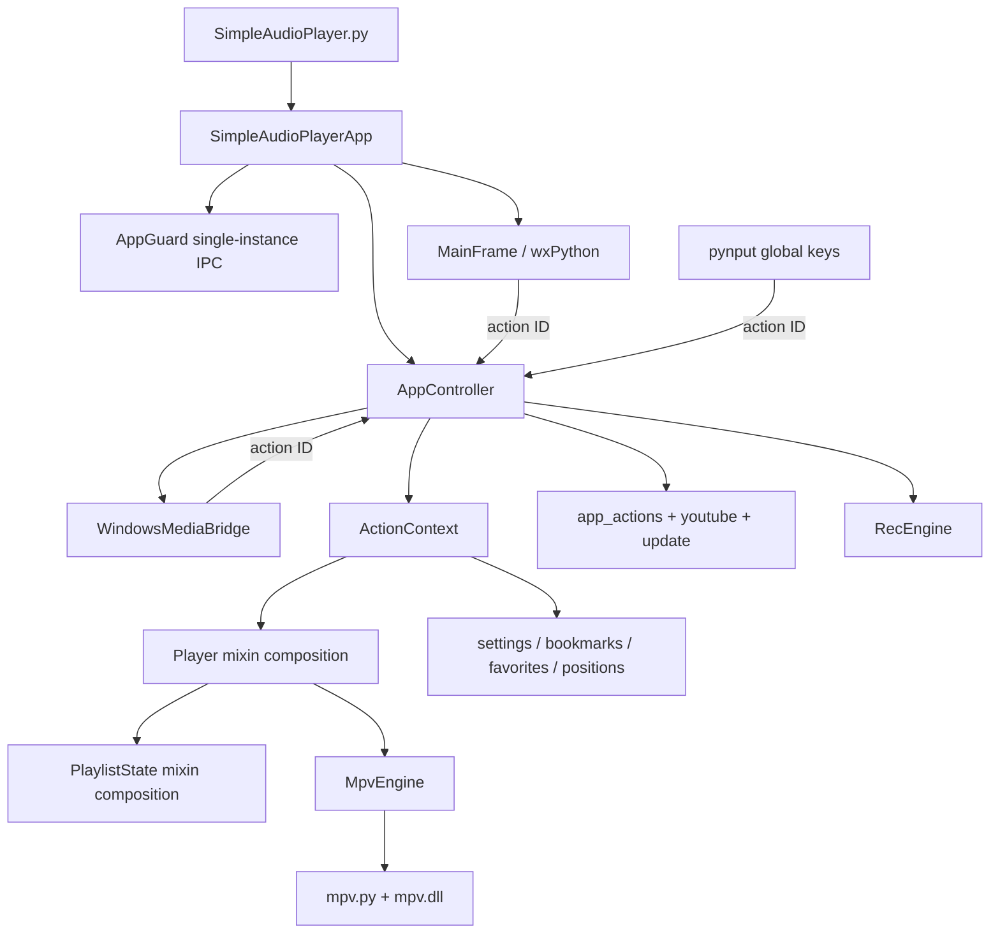

# Simple Audio Player — AI Project Reference

> Generated from the repository state on 2026-07-13. This is a code-discovery reference, not a user guide. It is intended to give an AI model or new maintainer enough context to reason about the project safely before changing it.

## 1. How to use this reference

This document describes the current implementation under `player/` and the repository-level build, release, and specification material one directory above it. When facts conflict, use this precedence order:

1. Current executable code and build configuration.
2. Current tests, if present.
3. Current feature contracts under `../specs/`.
4. User-facing documentation and historical review material.
5. This reference.

The code remains the final source of truth. This file deliberately records discrepancies, historical claims, and unverified behavior instead of presenting them as confirmed facts.

## 2. Project identity and scope

**Product:** Simple Audio Player
**Current code version:** `1.5.0`
**License:** MIT
**Primary platform:** Windows desktop
**Primary language:** Python
**GUI:** wxPython
**Playback backend:** libmpv through the vendored `mpv.py` binding and `mpv.dll`
**Accessibility:** keyboard-first design plus `accessible_output3` speech
**Repository:** `https://github.com/kamalyaser31/simple-player`

The application plays local audio/media files, folders, direct HTTP(S) streams, YouTube videos/playlists/search results, and can record microphone input to WAV or MP3. It also supplies bookmarks, favorites, per-file positions, A-B looping, shuffle/repeat, FFmpeg audio filters, configurable local/global shortcuts, Windows file associations, Windows System Media Transport Controls (SMTC), localization, application updates, and YouTube helper updates.

The repository root is the parent of this directory:

```text
simple-player/
├── .github/workflows/release.yml  # Windows release pipeline
├── build_test.ps1                 # Local equivalent of release build
├── info.json                      # Published version metadata
├── README.md                      # Product/build overview
├── TECHNICAL_REFERENCE.md         # Older technical reference; may drift
├── specs/                         # Historical review and blocker contracts
├── winsdk/_winrt.pyd              # Patched WinRT binary copied after build
└── player/                         # Application source and this document
```

## 3. Platform and runtime requirements

The implementation is Windows-specific in several places: `winreg`, `ctypes.windll`, file-association registry writes, `os.startfile`, Windows shell operations, AppGuard IPC, SMTC through `winsdk`, and bundled PE binaries. Some utility code contains non-Windows config-path fallbacks, but the application as a whole should be treated as Windows-only.

The release workflow uses Python 3.11 on `windows-latest`. The README recommends Python 3.11. The source imports these direct Python dependencies from `requirements.txt`:

| Dependency | Role |
|---|---|
| `wxpython` | GUI, dialogs, events, timers, native window handle |
| `pynput` | Process-wide/global keyboard listener |
| `appGuard` | Single-instance lock, IPC, focus existing window |
| `accessible_output3` | Screen-reader/speech output abstraction |
| `py-yt-search` | YouTube search and continuation pages |
| `winsdk` | Windows SMTC/media session integration |
| `certifi` | CA bundle for frozen HTTPS requests |
| `pyaudio` | Microphone capture and recording beeps |
| `lameenc` | MP3 recording encoder |

Build-only requirements are PyInstaller, and Inno Setup 6 for the installer. Maintenance scripts additionally expect Black, Flake8, and GNU `xgettext` depending on the task; those tools are not listed in `requirements.txt`.

Runtime binary assets:

| Asset | Purpose | Source-control/build behavior |
|---|---|---|
| `mpv.dll` | libmpv playback backend | Tracked and bundled by PyInstaller |
| `mpv.py` | Python ctypes binding for libmpv | Vendored source, not an application-owned module to casually rewrite |
| `yt-dlp.exe` | YouTube inspection/resolution/download | Present in this working tree but ignored/untracked; installed or updated at runtime |
| `deno.exe` | JavaScript runtime passed to yt-dlp | Present in this working tree but ignored/untracked; installed at runtime |
| `sounds/speaker_test.wav` | Output-device test sound | Tracked and bundled |
| `winsdk/_winrt.pyd` | Patched WinRT extension | Stored at repository root and copied into the distribution after PyInstaller |

Internet is required only for YouTube features and update checks/downloads. Local playback and recording should remain usable when the network or YouTube helpers are unavailable.

## 4. Entry points and startup lifecycle

### 4.1 Source entry point

`SimpleAudioPlayer.py` is intentionally tiny:

1. Collect every non-empty command-line argument as an initial path.
2. Construct `SimpleAudioPlayerApp(False, initial_paths=...)`.
3. Enter `wx.App.MainLoop()`.

Run from source from `player/`:

```powershell
python SimpleAudioPlayer.py
```

Imports are written as top-level imports such as `from app import ...`, so the current working directory or `PYTHONPATH` must make `player/` importable.

### 4.2 Single-instance behavior

`app.py` uses these AppGuard names:

- Main instance handle: `SimpleAudioPlayer.MainInstance`
- Open-path IPC handle: `SimpleAudioPlayer.OpenPaths`

The primary process registers an IPC message handler. A secondary process serializes `{"paths": [...]}` to JSON, sends it to the primary process, asks AppGuard to focus the window named `Simple Audio Player`, releases AppGuard, and exits without entering the main loop. AppGuard failures are intentionally permissive: if initialization or primary-instance checks fail, the process continues as if primary.

IPC payload parsing accepts dictionaries, lists, bytes, strings, several AppGuard message attribute names, and a legacy plain-path fallback. Incoming shell requests restore and raise the frame, then pass paths through a 120 ms one-shot debounce queue so multiple Explorer launches become one playlist operation.

### 4.3 Deferred application initialization

Startup deliberately creates a minimal `_BootstrapController` before the heavy controller:

1. Initialize AppGuard and stop if this is a secondary instance.
2. Create and load `SettingsManager`.
3. Build `_BootstrapController`, which exposes shortcut data but no operational actions.
4. Initialize localization before building most of the UI.
5. Create and show `MainFrame`.
6. Register IPC and schedule full initialization with `wx.CallAfter`.
7. Construct `AppController`, replace the bootstrap controller in the frame, attach the render window, start SMTC/global shortcuts, and run startup tasks.
8. Check YouTube helper availability and optionally install missing components.
9. Start background application/yt-dlp update checks according to settings.
10. Open initial/IPC paths, or restore the last local session if no paths were supplied.
11. Speak the welcome message.

If full controller initialization raises, the app prints a traceback, shows a generic initialization error, and closes the frame.

### 4.4 Shutdown

The frame close path calls the controller shutdown. `AppController.shutdown()`:

- cancels YouTube sessions/tasks, update work, and playlist-info workers before teardown;
- stops the global keyboard listener;
- stops the SMTC update timer;
- stops recording without a beep;
- optionally saves the active per-file position;
- copies current volume and speed into settings;
- optionally saves the last local file and elapsed position;
- persists settings according to `save_on_close` semantics;
- closes the Windows media bridge;
- terminates the player/libmpv instance.

Each shutdown operation is best-effort and logs its own failure, so one broken subsystem cannot prevent later cleanup.

`wx.App.OnExit()` separately stops the shell timer, unregisters AppGuard IPC, and releases AppGuard.

## 5. Architecture

The project is an action-driven desktop MVC variant. The UI emits action identifiers; `AppController` maps identifiers to functions; the functions receive an `ActionContext` and operate on `Player`, stores, settings, dialogs, and speech.



### 5.1 Major ownership rules

- `app.py` owns process bootstrap, single-instance IPC, and startup ordering.
- `actions.py` owns stable action IDs, labels, and default local/global shortcuts.
- `core/controller.py` owns action routing and coordination among player, UI, stores, recording, shortcuts, updates, and Windows media.
- `core/action_context.py` is the dependency/state bundle passed to action functions.
- `app_actions/` owns user commands unrelated to YouTube internals.
- `core/player/` owns player-facing behavior and delegates raw playback to `MpvEngine` and playlist state to `PlaylistState`.
- `core/mpv_engine.py` is the only application wrapper that should manipulate raw MPV options/properties/filters.
- `playlist/state/` owns ordered sources, current selection, shuffle, repeat, metadata, and marks.
- `ui/` owns wx controls and presentation; long blocking work should not run on the wx thread.
- `youtube/` owns YouTube validation, helper lifecycle, resolution, session state, prefetch, result UI orchestration, and downloads.
- `recording/` owns microphone capture and output encoding.
- `bookmarks/`, `favorites/`, and `positions/` own their independent JSON stores.
- `update/` owns application update discovery/download/UI; `updater/` applies downloaded assets after process exit.

### 5.2 Composition and mixins

Three central objects are split through multiple inheritance:

- `Player`: window, loading, playback, filters, state facade, file mutation, and lifecycle mixins.
- `PlaylistState`: core getters, loading, navigation, mutation, marks, and metadata mixins.
- `MainFrame`: menu construction, state/enablement, and event handling mixins plus `wx.Frame`.

Keep mixins narrowly scoped. Shared state is initialized in the concrete class. Avoid creating another parallel state owner when adding behavior.

### 5.3 Duplicate/compatibility modules

`playlist/state/` is the canonical playlist-state implementation. The former duplicate `playlist/state.py` and unused empty `core/player/export.py` were removed after import and reference checks. `ui/settings_dialog.py`, `youtube/actions.py`, and package `__init__.py` files primarily provide intentional compatibility/re-export surfaces.

## 6. Runtime object and state model

### 6.1 `AppController`

At construction the controller creates:

- one `Player`;
- one `RecEngine`;
- one `MarkStore`, `FavStore`, and `PosStore`, all rooted beside `settings.ini`;
- one `ActionContext` referencing those objects;
- one custom `WindowsMediaBridge`;
- local and global `ShortcutManager` instances;
- the action-handler dictionary;
- later, one global `KeyboardHandler` and a 1-second wx media timer.

Settings are immediately applied to player volume, speed, end behavior, wrapping, output device, normalization, mono, and silence-removal configuration.

### 6.2 `ActionContext`

The context carries `player`, `settings`, `marks`, `file_pos`, `favs`, optional `frame`, A-B selection state, YouTube session/current-item state, and file-info multi-press state. It centralizes beginner-versus-advanced speech:

- beginner mode uses the descriptive message;
- advanced mode uses the concise message.

UI state updates are guarded when no frame exists. Selection state is reset when relevant media changes.

### 6.3 Playlist state

The playlist stores:

- `_file_list`: ordered playback entries; entries may be local paths or resolved stream URLs;
- `_current_index` and `_current_path`;
- `_pending_start`: one-time resume position consumed during load;
- `_meta`: normalized-path/URL keyed dictionaries containing optional display `title` and original `source`;
- shuffle enabled/order/position and a private PRNG;
- repeat-file flag;
- normalized marked-file keys.

For URLs, the path key is the URL unchanged. For local paths, it is `normcase(abspath(path))`.

YouTube entries use a resolved temporary stream URL as the playlist path and the canonical YouTube page URL as metadata `source`. This distinction is critical: display/current-video behavior should use title/source metadata rather than treating the expiring stream URL as the durable identity.

### 6.4 Player lifecycle

The player registers an MPV end-file callback. EOF and errors are distinguished by numeric MPV reason (`0` EOF, `4` error). Repeat-file and configured end behavior determine whether to reload, advance, or stop. A controller-supplied finished-file handler lets `youtube.flow.on_playback_finished()` take ownership of YouTube auto-advance before the normal local-playlist path continues.

## 7. Module map

### Root modules

| Module | Responsibility |
|---|---|
| `SimpleAudioPlayer.py` | Source/PyInstaller entry point |
| `app.py` | wx app bootstrap, AppGuard, IPC, deferred controller startup |
| `actions.py` | Action dataclass, IDs, default shortcut registries, percentage/bookmark maps |
| `speech.py` | Single `accessible_output3` auto-speaker and `speak()` wrapper |
| `mpv.py` | Vendored low-level python-mpv binding |
| `requirements.txt` | Direct runtime dependencies |
| `SimpleAudioPlayer.spec` | Main PyInstaller one-folder build |
| `simple_audio_player.iss` | Per-user Inno Setup installer and registry integration |

### `app_actions/`

| Module | Responsibility |
|---|---|
| `bookmark_actions.py` | Add/manage/jump local-file bookmarks |
| `device_actions.py` | Output-device selection dialog |
| `favorite_actions.py` | Favorite CRUD and type-specific open behavior |
| `file_actions.py` | Open modes, shell paths, local file operations, navigation, restore, position tracking |
| `help_actions.py` | Localized guide/change log, contact links, about dialog |
| `marked_file_actions.py` | Marking and batch copy/move/delete/clipboard operations |
| `playback_actions.py` | Seek, time/percent jumps, volume, speed, filters, A-B loop, announcements |
| `recording_actions.py` | Build recording options and control `RecEngine` |

### `config/`

| Module | Responsibility |
|---|---|
| `constants.py` | Product/version/update URLs, numeric bounds, audio extensions, YouTube defaults |
| `file_associations.py` | HKCU ProgID, Open With, context menu, capabilities, Explorer refresh |
| `localization.py` | Language discovery, wx locale, gettext binding, rebinding imported `_` functions |
| `settings_manager.py` | INI defaults, validation, legacy silence migration, shortcut persistence |
| `shortcut_utils.py` | wx event/config/display conversion and canonicalization |
| `shortcuts.py` | Immutable `Shortcut` and conflict-aware `ShortcutManager` |

### `core/`

| Module | Responsibility |
|---|---|
| `action_context.py` | Shared action dependencies and accessibility state |
| `controller.py` | Central action dispatcher and subsystem coordinator |
| `keyboard_handler.py` | Global pynput listener with held-key deduplication |
| `media_library.py` | Audio-extension folder scan, recursive two-phase progress/cancel scan |
| `mpv_engine.py` | Raw MPV lifecycle, properties, device selection, filters, window recreation |
| `windows_media.py` | Custom Windows SMTC session and timeline/status/button bridge |

### `core/player/`

| Module | Responsibility |
|---|---|
| `__init__.py` | Concrete `Player` composition and state initialization |
| `window.py` | Native render handle normalization, engine recreation, shutdown |
| `load.py` | Open file/folder/list/stream, queue stream, navigation, actual current load |
| `playback.py` | Playback controls and property facade |
| `filters.py` | Normalize, mono, silence-removal state and FFmpeg graph generation |
| `state.py` | Read-only/state facade over `PlaylistState` |
| `files.py` | Stop/close/delete/rename/remove paths or sources |
| `lifecycle.py` | MPV end-file decision path |

### Data stores

`bookmarks/`, `favorites/`, and `positions/` each have a dataclass model, a validating store, and a small JSON I/O module. All three JSON writers use a same-directory temporary file plus `os.replace()` for atomic replacement.

### `playlist/`

- `playlist/info.py` scans file duration/size in a worker, caches duration probes, and formats aggregate elapsed/remaining/total playlist information.
- `playlist/state/` is the active playlist-state package.

### `recording/`

- `engine.py`: locked recording state, PyAudio stream, daemon capture thread, blocking beeps, cleanup.
- `opts.py`: `RecOpts`, output directory creation, timestamped names.
- `sink.py`: WAV writer and streaming `lameenc` MP3 writer.

### `ui/`

| Area | Responsibility |
|---|---|
| `main_frame.py`, `mainwin/*` | Main frame, transport UI, menus, accelerators, state enablement, close/keyboard events |
| `prefs/*` | Settings dialog pages: general, backup, recording, YouTube, main dialog |
| `audio_settings.py` | Playback/audio settings page |
| `silence_removal.py` | Basic/advanced silence-removal editor and validation |
| `shortcut_settings.py` | Local/global shortcut capture, conflict checks, defaults |
| `dialogs.py` | File/folder pickers, go-to-time, opened-files, text and playlist info dialogs |
| `bookmark_dlg.py`, `favorite_dlg.py` | Store management dialogs |
| `task_dialogs.py`, `yt_dialogs.py` | Busy/progress/result dialogs |
| `sound_cards_dialog.py` | MPV output-device chooser |
| `help_dialogs.py`, `update_dialogs.py` | About and update prompt |
| `custom_controls.py` | Focus/keyboard adaptations for buttons and sliders |
| `accelerators.py` | wx accelerator-table construction from shortcut maps |

### `youtube/`

| Module | Responsibility |
|---|---|
| `actions.py` | Re-export facade used by controller |
| `components.py` | yt-dlp/Deno readiness, download, atomic Deno extraction, yt-dlp self-update |
| `link_validator.py` | Strict HTTP and YouTube host/link classification |
| `resolver.py` | yt-dlp inspection, metadata conversion, format selection, stream resolution |
| `search.py` | `py-yt-search` initial/continuation search state |
| `state.py` | YouTube session dictionaries, ownership, cancellation, current-item metadata |
| `flow.py` | Main open/search/results/play/prefetch/next/EOF orchestration |
| `results.py` | Result dialog event wiring and background load-more |
| `video.py` | Active-video download, description, link copy |
| `download.py` | yt-dlp M4A extraction subprocess and progress parsing |
| `startup.py` | Missing-component prompt and install dialog |
| `task_ui.py` | Worker/dialog adapter for cancellable YouTube jobs |
| `ui_utils.py` | Link prompts, chooser, clipboard/browser/folder/progress helpers |

### Updates and maintenance

- `update/service.py`: version parsing, remote `info.json`, release asset URL, streaming download.
- `update/actions.py`: startup/manual update workflows and progress dialogs.
- `updater/main.py`: separate process that waits for the app, applies ZIP or launches installer, and restarts when appropriate.
- `scripts/update_version.py`: synchronizes root `info.json`, Python `APP_VERSION`, and Inno `MyAppVersion`.
- `scripts/update_pot.py`: runs `xgettext` over Python sources.
- `scripts/format_code.py`: runs Black and then Flake8 over a target.
- `scripts/build_updater.bat`: builds windowed one-file `Updater.exe`.
- `scripts/validate_project_consistency.py`: read-only validation for version, associations, catalogs, packaging assets, updater marker, release naming, and the runtime-helper policy.

## 8. Action and shortcut system

`Action` is an immutable record containing `action_id`, English label, primary shortcut, and optional secondary shortcut. Action IDs are API-like identifiers: menus, accelerators, global hooks, SMTC, settings overrides, and controller routing depend on them. Renaming an ID requires migration of persisted shortcut keys.

`Shortcut` stores a canonical key token and a frozen set of modifiers. Local shortcuts are converted from wx events and installed as frame accelerators. Global shortcuts are captured and listened for through pynput. A held physical key is ignored until release via `_pressed_keys`, preventing repeat storms.

Only actions listed in `GLOBAL_SHORTCUT_ACTIONS` can be globally bound. Local and global conflict detection is performed within each settings scope, not across scopes.

### 8.1 Default local shortcuts

| Area | Defaults |
|---|---|
| Playback | Play/pause `Space` or `Enter`; previous `Shift+Tab` or `Page Up`; next `Tab` or `Page Down`; first `Ctrl+Home`; last `Ctrl+End` |
| Seek | Back/forward `Left`/`Right`; x2 `Ctrl+Left/Right`; x4 `Ctrl+Shift+Left/Right`; x8 `Shift+Left/Right`; start/end `Home`/`End` |
| Volume/speed | Volume `Up`/`Down`; max/min `Shift+Up/Down`; speed `Ctrl+Up/Down`; reset speed `Alt+Y` |
| Announcements | Volume `V`; elapsed `E`; remaining `R`; duration `T`; percent `P`; speed `S`; file info `F`; marked count `K` |
| Open/manage | File `Ctrl+O`; folder `Ctrl+Shift+O`; link `Ctrl+L`; YouTube link `Ctrl+Shift+Y`; search `Ctrl+Y`; favorites `Ctrl+Shift+F`; settings `Ctrl+P`; opened files `F2` |
| Local file operations | Containing folder `Ctrl+F`; properties `Alt+Enter`; close `Ctrl+W`; close all `Ctrl+Shift+W`; rename `Shift+F2`; delete `Shift+Delete`; copy current `Ctrl+Shift+C`; paste `Ctrl+V` |
| Marks | Toggle current `Ctrl+K`; mark all `Ctrl+A`; clear `Ctrl+Shift+K` |
| Bookmarks | Add `Shift+M`; manage `Ctrl+Shift+M`; jump slots 1–10 with `Alt+1`…`Alt+9`, `Alt+0` |
| A-B loop | Set A `[`, set B `]`, clear `Backspace` |
| Modes | Shuffle `Ctrl+Z`; repeat file `Ctrl+R`; silence removal `Ctrl+M`; verbosity `Ctrl+Shift+V`; sound cards `Ctrl+Shift+A` |
| YouTube item | Download `Ctrl+D`; description `Alt+D` |
| Recording | Start `F9`; pause/resume `F7`; stop `F8` |
| Help/test | Guide `F1`; speaker test `Ctrl+Shift+T` |

Seek-step presets use `Shift+1` through `Shift+0` for 1 second, 5 seconds, 1, 5, 10, 20, 30, 40, 50, and 60 minutes; custom uses `Shift+-`. Percentage jumps use `Ctrl+1`…`Ctrl+9`,`Ctrl+0` for 10% increments and `Ctrl+Shift+1`…`9`,`0` for 15%, 25%, …, 95%, 100%.

### 8.2 Default global shortcuts

All default global shortcuts use `Alt+Win`:

- play/pause `Space`;
- seek backward/forward `Left`/`Right`;
- volume up/down `Up`/`Down`;
- next/previous `Page Down`/`Page Up`;
- recording start/pause/stop `F9`/`F7`/`F8`.

### 8.3 Event dispatch

Menus, accelerators, global keys, and SMTC all ultimately call `AppController.handle_action(action_id)`. It schedules the handler using `wx.CallAfter`, then synchronizes frame toggles and Windows media state. This is a core threading invariant: background callbacks must not directly mutate wx widgets.

## 9. Local media and playlist behavior

Supported folder-scan audio extensions are:

```text
.aac .aiff .alac .flac .m4a .mp3 .mp4 .ogg .opus .wav .wma
```

The registry integration adds additional video extensions for Open With/context-menu support, including `.3gp`, `.avi`, `.flv`, `.m2ts`, `.m4v`, `.mkv`, `.mov`, `.mpeg`, `.mpg`, `.ts`, `.webm`, and `.wmv`.

Open modes for a shell-opened/local selected file:

- `file_only`: play only that path;
- `main_folder`: scan supported files in the containing folder and select the requested file;
- `main_and_subfolders`: recursively scan with a cancellable progress dialog, then select the requested file.

Opening an explicit folder scans it into a sorted list. Opening multiple shell paths filters/normalizes them and creates a playlist. Direct HTTP(S) links are opened as streams. Clipboard paste accepts Windows file-drop data, file URIs, and path-like text, then delegates to the same open logic.

Playlist navigation supports sequential or randomized order. Wrapping is optional. Repeat-file is separate from wrapping. `end_behavior` accepts:

- `advance`: move to next item at EOF;
- `loop`: reload the current file;
- `none`: stop at EOF.

The exact precedence among repeat, end behavior, YouTube EOF handling, and local next behavior lives in `core/player/lifecycle.py`; preserve it when changing EOF code.

Local-only operations are enabled only when `os.path.isfile(current_path)` is true. Rename updates playlist identity and metadata. Delete/close/remove operations keep current index valid, select the closest remaining entry, and clear player state when the list becomes empty. Batch marked-file operations run copies/moves/deletes with progress/cancellation and reconcile removed/renamed playlist entries.

Playlist information probes media durations through a lightweight MPV instance, caches by normalized path, sums file size and duration, and reports position within the list plus elapsed/remaining aggregate time.

## 10. Playback engine and audio processing

### 10.1 MPV ownership

`MpvEngine` wraps exactly one `mpv.MPV` core at a time. The engine disables MPV keyboard bindings so wx owns focused input. The custom `WindowsMediaBridge` is the selected Windows media command/status owner; MPV playback remains the playback owner. MPV's `media-controls` and `input-media-keys` options are disabled to prevent duplicate Windows sessions and commands.

The engine can be recreated for a native video window handle. Before recreation it snapshots source, position, pause, volume, speed, and device; after recreation the player reapplies end behavior and filters and reloads/resumes the current item. Negative native handles are normalized with a 32-bit mask.

Network-related MPV defaults include a bounded network timeout. Safe option setters tolerate MPV builds that lack a particular option.

### 10.2 Volume and speed

Logical volume range is 0–1000, default 100. The ordinary shortcut step defaults to 5 and is clamped to 1–20 in settings. Up to 100 uses MPV volume directly. Above 100, MPV volume is held at 100 and a labeled FFmpeg volume preamp filter supplies up to 10x gain. This design means filter composition must preserve the preamp label and other active filters.

Speed range is 0.5–4.0, default 1.0, default step 0.1. Action code clamps changes to these constants.

### 10.3 Filters

Active audio processing is reconstructed as state changes:

- normalization/limiting uses `dynaudnorm` plus `alimiter`;
- mono uses `aformat=channel_layouts=mono`;
- high logical volume uses a labeled `volume` preamp;
- silence removal uses a generated `silenceremove` FFmpeg graph.

Silence options are string-backed because they are inserted into an FFmpeg graph after UI validation. Detection is `peak` or `rms`. Threshold normalization accepts values and appends/normalizes dB where appropriate. Avoid passing unvalidated arbitrary graph fragments into MPV.

### 10.4 A-B selection

The action context stores selection start, end, and the media path that owns them. Set A records current elapsed time. Set B must follow A and applies loop points. Seek actions constrain movement when a complete selection is active. Changing media resets selection state. Bookmarks and A-B selection apply to durable local media, not arbitrary resolved stream identities.

### 10.5 Output devices and SMTC

MPV exposes `audio_device_list`. Device selection validates availability and falls back to `auto` if a saved device disappears. Speaker test uses the bundled WAV.

`WindowsMediaBridge` creates a `GlobalSystemMediaTransportControlsSession`-style integration through winsdk, maps play/pause/next/previous buttons back to controller action IDs, publishes title/status, and updates timeline data every second. All initialization/update/close paths are defensive: failure disables the bridge rather than breaking playback.

## 11. YouTube subsystem

### 11.1 Helper readiness and installation

YouTube requires both `yt-dlp.exe` and `deno.exe` in the application directory. Readiness states distinguish `missing`, `ready`, `broken`, and `repair-required`. Validation can execute helpers with short timeouts instead of checking existence only. Recovery text instructs users to update/reinstall components.

At startup, `youtube.startup.check_startup()` checks helpers before ordinary startup playback. Depending on the dialog and saved skip choice, the user may install missing helpers or continue without YouTube. Local playback must remain available.

Component sources:

- yt-dlp channels: `stable`, `nightly`, `master`, mapped to their GitHub repositories/update channels;
- Deno: latest GitHub release ZIP for Windows x86_64.

Deno installation downloads a ZIP, extracts to a temporary path, validates, and atomically replaces the executable so an interrupted extraction does not masquerade as ready. Temporary files are cleaned. yt-dlp update uses its self-update mechanism and captures output. Helper directory is prepended to `PATH`, and Deno is supplied through yt-dlp's `--js-runtimes` option when available.

### 11.2 Link classification

`parse_link()` first requires a syntactically valid `http` or `https` URL with a network location. Non-YouTube HTTP URLs become generic streams. YouTube recognition accepts `youtu.be`, `youtube.com`, and subdomains after removing port/trailing dot.

The classifier identifies video IDs in `v=`, `youtu.be/<id>`, `/shorts/`, `/embed/`, `/live/`, and `/v/`; playlist IDs in `list=`; and channel paths including `/channel/`, `/c/`, `/user/`, and `/@handle`. Mixed video+playlist links are resolved according to `mixed_link_mode`: ask, video, or playlist. Favorite type can force video, playlist, combined, or bypass YouTube as generic stream.

Known edge: the final fallback in `_yt_meta()` classifies some otherwise unsupported YouTube pages as `video` even without a proven video ID. This was recorded historically as YT-006 and remains relevant unless code changes.

### 11.3 Search and inspection

Search uses `py-yt-search` with configured language/region and an initial limit of 50. `SearchState` stores continuation state and can load more when the selection reaches the end. Search output is converted to the common `YtItem` model:

```text
YtItem(title, url, channel_url, channel_name, description="")
```

Direct link inspection uses yt-dlp. Playlist inspection uses flat playlist JSON and tolerates individual invalid entries. Video inspection requests single-item JSON. Channel links currently produce a channel result without playable items rather than a normal result list.

### 11.4 Resolution strategy

Format selection:

- audio-only: `bestaudio[ext=m4a]/bestaudio/best`;
- low video: best MP4/stream at or below roughly 360p;
- medium: best MP4/stream at or below roughly 720p;
- best: best MP4, then best.

Resolution first requests single-item JSON and reads a direct/requested format URL. If absent, it calls yt-dlp `-g` with the selected format, then a generic `-g` fallback. Diagnostic subprocess output is shortened and attached to user-facing `ResolveError` text. HTTP 429/rate-limit text receives special handling.

### 11.5 Session state and ownership

A YouTube session is a dictionary with this contract:

```text
kind, title, items, sel, urls, search,
queued, next_jobs, prep_jobs, more_jobs,
pending_next, cancel, prep_keys
```

`ctx.yt_pl` is the active playback/results session; `ctx.yt_now` caches metadata for the currently playing canonical YouTube URL. Installing a new active session cancels the previous session's flag/futures. Closing a secondary results dialog performs targeted cleanup and only clears `ctx.yt_pl` when that exact session owns it.

When session-owned player sources are removed (for example, Escape returns from playback to results), `sync_removed_sources()` removes matching `queued` entries and invalidates a matching `pending_next`. This is necessary because the player queue and session queue markers are separate representations.

### 11.6 Playback, prefetch, next, and EOF

`youtube.flow` owns a shared background preparation pool, result/session orchestration, and a locked process-local resolved-stream cache. Cache keys include canonical URL, audio-only mode, and quality. Records use `time.monotonic()`, expire after 600 seconds, and are bounded to 200 entries; stale records and failed futures are evicted.

Starting an item:

1. Promote the displayed session to active ownership.
2. Resolve metadata and an ephemeral stream in a worker/dialog.
3. Open the stream in `Player` with canonical URL as `source` and title metadata.
4. Store current item metadata in `ctx.yt_now`.
5. Prefetch following entries and queue the next resolved stream when ready.

Explicit Next verifies whether a supposedly queued source actually exists in player state. A fresh resolution replaces the queued playable URL for the same canonical source, so an expired URL cannot survive merely because its source is already queued. If preparation is pending, it records `pending_next`; completion can automatically advance. Failures clear pending state and provide speech. MPV end-file reasons reach the YouTube handler: natural EOF attempts normal advancement, while a playback error evicts and resolves/reloads that source exactly once even when its cache record has already expired, before normal fallback behavior resumes.

Escape during active YouTube playback removes session-owned resolved sources and reopens/returns to results while preserving the correct session. This path is one of the most regression-sensitive areas in the project.

### 11.7 Downloads and current-video actions

Audio download always invokes yt-dlp with single-item extraction to M4A and an output template of `%(title)s.%(ext)s`. A dedicated reader thread consumes stdout so a blocking `readline()` cannot prevent cancellation, while the UI still receives parsed `[download] N% of SIZE` progress. Sixty seconds without output is treated as inactivity. Resolver/metadata subprocess calls are bounded to 90 seconds.

Current-video actions use the canonical `current_source`:

- copy the YouTube URL;
- fetch/show description, using `ctx.yt_now` when possible;
- download audio.

`youtube.state.is_yt()` uses substring matching in the parsed host, which is looser than `link_validator.py`; reuse the strict validator when hardening this behavior.

### 11.8 Concurrency and cancellation

Search, resolution, prefetch, load-more, downloads, component installation, and updates use worker threads/futures. Background-to-UI communication uses queues, future callbacks, timers, and `wx.CallAfter`. Cancellation is cooperative via `CancelFlag`; subprocess owners use shared terminate, bounded wait, kill, final wait, and pipe-close cleanup. YouTube tracks and shuts down its preparation executor, and invalidated preparation futures cannot overwrite a newer cache result. Startup update checks use tracked daemon workers so a blocked network check cannot hold process exit; shutdown sets their cancellation guards and both completion callbacks and queued UI callbacks recheck shutdown state.

Do not block the wx event loop with network, filesystem-tree, media-probe, encoding, or subprocess work. Do not access destroyed dialogs from a future callback. Session callbacks must verify session identity and cancellation state before applying results.

### 11.9 Known YouTube hardening backlog

The historical ultra-review recorded five release blockers that current code/specs indicate were addressed: targeted session ownership, queue synchronization after source removal, natural EOF advance, atomic Deno integrity, and single Windows media owner. Automated notes say those passed at the time, but live/manual Windows validation was not recorded.

The following non-blocker risks remain visible in current code or historical review and should be re-verified before related work:

- unsupported YouTube pages can reach late resolution failure;
- some background load-more/prefetch failures remain silent;
- result-dialog Enter handling may override focused buttons;
- progress accessibility needs real screen-reader validation;
- settings-derived prefetch/language/region values are not fully hardened against manual edits;
- current-source YouTube detection is looser than input validation;
- description fetch failure is presented like an empty description;
- result labels are title-only and can be ambiguous.

Treat these as investigation leads, not automatically proven defects in every environment.

## 12. Recording subsystem

Recording captures the default PyAudio input device as signed 16-bit PCM at 44.1 kHz with a 1024-frame chunk. User configuration selects mono/stereo, WAV/MP3, MP3 bitrate 32–320 kbps, and output folder. Filenames are `recording_YYYYMMDD_HHMMSS.ext`.

`RecEngine` state is protected by a lock. Start creates PyAudio, plays an 880 Hz beep, waits 100 ms, creates the sink/input stream, and starts a daemon `RecorderThread`. Pause keeps reading but discards captured chunks. Resume beeps before accepting chunks again. Stop signals and joins the thread for up to 2 seconds, closes input, optionally plays a 440 Hz beep, finalizes the sink, and resets state.

WAV uses the standard `wave` module. MP3 streams PCM through `lameenc.Encoder` with quality setting 2 and flushes at close. The default folder is `%USERPROFILE%\Documents\Simple Audio Player\recordings`.

Recording is microphone/input capture, not direct capture of MPV output. Error paths should preserve actionable dependency/device messages and always finalize/close handles.

## 13. UI and accessibility contract

The primary design is keyboard-first and screen-reader-friendly. Preserve these rules:

- Every important action must remain reachable by keyboard or menu.
- Action results and failures should produce spoken and/or visible feedback appropriate to context.
- Beginner/advanced verbosity must use `ActionContext.speak()` rather than bypassing it without reason.
- Long work must leave the wx loop responsive and offer cancellation when practical.
- F1 context help in Settings is resolved by asking each page about the focused child control.
- Dialog validation should keep the dialog open and focus/explain invalid input.
- Menu enablement reflects current state: file loaded, local file, marked files, bookmark eligibility, active YouTube item, recording state.
- Shortcut labels are rebuilt after customization so menus match real bindings.

Main frame UI consists of transport buttons, a video/render panel, and menus for File, Edit, Bookmarks, marked-file actions, Player, Video options, Recording, and Help. `MainFrameStateMixin` is the central enable/check owner; do not scatter competing enablement logic into individual actions.

Speech is implemented by one global `accessible_output3.outputs.auto.Auto()` object. `speech.speak(text, interrupt=True)` interrupts by default. Failures in speech initialization are not wrapped in `speech.py`, so packaging/accessibility dependency changes should be tested early in startup.

The file-info action intentionally uses repeated presses within roughly 0.3 seconds to cycle from filename, to folder, to copying the full path. Preserve this temporal interaction when refactoring action context or announcements.

## 14. Configuration

### 14.1 Location and save semantics

On Windows, configuration directory is `%APPDATA%\Simple Audio Player`. If `APPDATA` is missing it falls back to `~/AppData/Roaming/Simple Audio Player`. The main file is `settings.ini`.

On non-Windows, the path fallback is `$XDG_CONFIG_HOME/Simple Audio Player` or `~/.config/Simple Audio Player`, but this does not make the complete application portable.

`SettingsManager.load()` overlays disk values on defaults. A malformed INI resets in-memory configuration to defaults. Legacy silence-removal keys under `[audio]` are migrated to `[silence_removal]`.

Important save behavior:

- normal saves use a same-directory temporary file, flush and `fsync`, parse the temporary INI, then replace `settings.ini`; failures preserve the previous file and clean the temporary file;
- when `save_on_close=false`, shutdown preserves existing disk settings and writes only `ui.save_on_close=false` rather than persisting the session's other changes;
- explicit settings-dialog saves occur when OK is accepted; if persistence fails, the pre-dialog in-memory configuration is restored before the error is reported;
- language changes require restart because already-built widgets are not reconstructed.

### 14.2 Default settings and accepted values

| Section.key | Default | Validated behavior |
|---|---:|---|
| `audio.volume` | `100` | Integer clamped 0–1000 |
| `audio.speed` | `1.0` | Actions clamp 0.5–4.0 |
| `audio.device` | empty | MPV device name, fallback auto |
| `audio.seek_step_key` | `2` | Preset key; custom key is `-` |
| `audio.seek_step_custom` | `5` | Float seconds, UI validated |
| `audio.speed_step` | `0.1` | Positive float or fallback |
| `audio.volume_step` | `5` | Integer clamped 1–20 |
| `audio.end_behavior` | `advance` | `advance`, `loop`, `none` |
| `audio.wrap_playlist` | `false` | Boolean |
| `audio.save_file_pos` | `false` | Boolean |
| `audio.audio_normalize_enabled` | `true` | Boolean |
| `audio.audio_mono_enabled` | `false` | Boolean |
| `silence_removal.enabled` | `false` | Boolean |
| `silence_removal.advanced` | `false` | Boolean/UI mode |
| `silence_removal.start_periods` | `1` | Integer text |
| `silence_removal.start_duration` | `0.2` | Float seconds text |
| `silence_removal.threshold` | `-30` | dB-like threshold text |
| `silence_removal.stop_periods` | `-1` | Integer text |
| `silence_removal.stop_duration` | `0.5` | Float seconds text |
| `silence_removal.stop_silence` | `0.2` | Float seconds text |
| `silence_removal.window` | `0.02` | Float seconds text |
| `silence_removal.detection` | `peak` | `peak` or `rms` |
| `ui.last_dir` | empty | Last chooser directory |
| `ui.verbosity` | `beginner` | Beginner/advanced behavior |
| `ui.open_with_files_mode` | `file_only` | `file_only`, `main_folder`, `main_and_subfolders` |
| `ui.check_app_updates` | `true` | Boolean |
| `ui.save_on_close` | `true` | Boolean with special persistence semantics |
| `ui.speak_file_on_nav` | `false` | Boolean |
| `ui.language` | `system` | System/default or locale directory code |
| `youtube.skip_prompt` | `false` | Missing-helper prompt preference |
| `youtube.audio_only` | `true` | Boolean |
| `youtube.video_quality` | `medium` | `low`, `medium`, `best` |
| `youtube.mixed_link_mode` | `ask` | `ask`, `video`, `playlist` |
| `youtube.yt_dlp_channel` | `stable` | `stable`, `nightly`, `master` |
| `youtube.check_yt_updates_startup` | `false` | Boolean |
| `youtube.prefetch_count` | `5` | UI uses 1–20; getter does not clamp manual values |
| `youtube.search_language` | `en` | Free text passed to search |
| `youtube.search_region` | `US` | Free text passed to search |
| `recording.channels` | `stereo` | `mono`, `stereo` |
| `recording.quality` | `192` | Integer clamped 32–320 |
| `recording.format` | `wav` | `wav`, `mp3` |
| `recording.folder` | Documents default | Non-empty path |
| `playback.remember_position` | `false` | Boolean |
| `playback.last_file` | empty | Local path only on save |
| `playback.last_position` | `0` | Float seconds |

Optional sections `shortcuts`, `shortcuts_secondary`, and `global_shortcuts` map stable action IDs to serialized shortcut strings. Only overrides that differ from defaults are written by the settings UI.

## 15. Persistent data contracts

All feature stores live beside `settings.ini` under the roaming profile.

### 15.1 Bookmarks: `bookmarks.json`

Top-level schema:

```json
{"version": 1, "files": {"NORMALIZED_PATH": [{"id": "hex", "name": "...", "path": "...", "pos": 12.3, "created": 0.0}]}}
```

Bookmarks are grouped by normalized local path/URL and sorted by position, creation time, then name. UI eligibility currently restricts bookmarks to active local files whose source is not YouTube. Quick slots are the first ten sorted bookmarks, not permanent slot numbers stored in JSON.

### 15.2 Favorites: `favorites.json`

```json
{"version": 1, "items": [{"id": "hex", "name": "...", "kind": "video", "link": "https://...", "created": 0.0}]}
```

Kinds are exactly `video`, `playlist`, `combined`, and `generic_stream`. Items are sorted by creation time then name.

### 15.3 Per-file positions: `positions.json`

```json
{"version": 1, "files": {"NORMALIZED_PATH": {"path": "...", "pos": 12.3, "updated": 0.0}}}
```

This store is separate from the single `playback.last_file/last_position` startup restore. Per-file positions are saved/restored during navigation only when `audio.save_file_pos` is enabled and the media is trackable. Values are non-negative seconds.

### 15.4 Corruption and atomicity

JSON readers return an empty object on absent, malformed, or unreadable files. Model conversion skips invalid rows. All three writers use the shared atomic writer: create a same-directory temporary file, write UTF-8 JSON, flush and `fsync`, validate the temporary JSON object, replace the target, then clean leftovers. This favors recovery over surfacing corruption; silent reset/data loss is possible if a corrupted file is later overwritten.

Backup/restore UI treats settings and bookmarks separately. Favorites and positions are not exposed by the same explicit import/export controls. Any schema change needs backward-compatible readers or a versioned migration.

## 16. Windows integration

### 16.1 File associations

Both the settings action and installer use per-user HKCU registration; no elevation is required. The principal ProgID is `SimpleAudioPlayer.media`. Registration creates:

- ProgID open command;
- `Play with Simple Audio Player` shell verb;
- `Applications/<exe>` Open With registration and SupportedTypes;
- `Software\SimpleAudioPlayer\Capabilities`;
- `Software\RegisteredApplications` entry;
- extension default/OpenWithProgids entries.

Source-mode commands use `pythonw.exe` when available and invoke `SimpleAudioPlayer.py "%1"`. Frozen commands invoke the executable directly. After changes, `SHChangeNotify(SHCNE_ASSOCCHANGED, ...)` refreshes Explorer.

The installer also writes associations directly and removes its own keys during uninstall. The consistency validator compares the Python audio/video registries with the file-dialog audio wildcard and every Inno extension block: SupportedTypes, class defaults, OpenWithProgids, and capabilities.

### 16.2 Single instance and shell opening

File associations launch one process per shell request, but AppGuard forwards paths to the existing primary. The 120 ms coalescing timer is part of correct multi-selection behavior. Changes to startup or IPC must cover initial command-line paths, requests arriving before controller readiness, and requests arriving after readiness.

### 16.3 Windows media

The custom bridge is the sole intended media-session owner. It is optional at runtime: missing/broken winsdk must degrade to keyboard/UI playback. The release build replaces the wheel-provided WinRT binary name with the repository-patched `_winrt.pyd`; skipping that patch may crash or disable media controls.

## 17. Localization and documentation

Gettext domain is `SimpleAudioPlayer`. Runtime locale root is `<app>/locale`. Available languages are discovered only when `locale/<code>/LC_MESSAGES/SimpleAudioPlayer.mo` exists. Arabic and Czech catalogs both use the required `SimpleAudioPlayer.po`/`.mo` domain filenames.

Localization initialization:

1. Select system/default or an explicit code.
2. Set/unset `LANGUAGE`.
3. Initialize `wx.Locale`.
4. add gettext lookup path/catalog;
5. install gettext translation into `gettext` and `builtins._`;
6. rebind already-loaded module globals that still point at `gettext.gettext`.

Most modules import `_` at module import time, which explains the explicit rebinding step. New UI strings should use `_()` and be extractable by `scripts/update_pot.py`.

User guides and change logs exist in `docs/en` and `docs/ar`. Help lookup tries selected/system language variants, then English. User-guide titles are version-neutral so they cannot drift from `APP_VERSION`; release metadata remains the technical version source of truth.

## 18. Networking, security, and error boundaries

HTTP calls use `urllib.request` with a product User-Agent. `helpers/http_utils.open_url()` supplies a certifi-backed SSL context for frozen builds. Update downloads stream in 64 KiB chunks and report size/download/pct. GitHub/raw GitHub are trusted update origins hard-coded in constants.

Security-sensitive boundaries:

- downloaded application updates are not cryptographically signature-verified in application code;
- helper binaries are downloaded from project upstream GitHub releases and validated mainly by executability/version behavior, not pinned hashes;
- updater ZIP handling uses `ZipFile.extractall()` into a temporary directory and then copies relative paths into the install root; it has no application-level member allowlist or explicit resolved-path containment check, so archive-handling changes require a dedicated traversal review;
- URLs and shell/file paths come from dialogs, clipboard, command line, IPC, favorites, and remote YouTube metadata; validate at the owning boundary;
- subprocesses are launched with argument arrays and `CREATE_NO_WINDOW`, not through `shell=True`;
- registry modifications are scoped to HKCU;
- file move/delete actions require confirmation and careful playlist reconciliation.

Error handling is intentionally defensive around optional Windows APIs, AppGuard, speech/UI callbacks, and MPV options. Do not broaden `except Exception` silently in core data mutations; use targeted recovery and preserve user feedback. Background future exceptions should be consumed and surfaced or logged, otherwise Python can hide failures until shutdown.

## 19. Application update system

Version source locations that must agree:

- `../info.json`;
- `config/constants.py: APP_VERSION`;
- `simple_audio_player.iss: MyAppVersion`.

`APP_UPDATE_INFO_URL` reads `main/info.json`. Version comparison extracts all numeric groups and compares them positionally, padding with zeros; it is not full semantic-version precedence.

Asset names are:

```text
SimpleAudioPlayer-v{version}.zip   # portable mode
SimpleAudioPlayer-v{version}.exe   # installer mode
```

Installer mode is detected by `.sap_installed` in the application directory. The installer creates that marker in its code section; portable builds do not have it.

Update flow:

1. Fetch and parse remote `{version, changes}`.
2. Compare with local version.
3. Prompt with changes.
4. Download the correct release asset to `%TEMP%/sap_update_<version>.<ext>`.
5. Start `Updater.exe <asset> <install_dir> <current_pid>`.
6. Close the app.
7. Updater waits up to 300 seconds for the PID.
8. ZIP mode extracts/copies payload and restarts `SimpleAudioPlayer.exe`; EXE mode launches the installer.

The updater is a separate one-file/windowed PyInstaller artifact. The main build includes it only when `player/Updater.exe` exists at spec evaluation time. CI explicitly builds/copies it first.

## 20. Build, installer, and release

### 20.1 Main PyInstaller build

From `player/`:

```powershell
python -m PyInstaller --noconfirm SimpleAudioPlayer.spec
```

The spec creates a windowed one-folder distribution at `player/dist/SimpleAudioPlayer/`. It bundles:

- accessible_output3 dynamic libraries/data;
- certifi data;
- `mpv.dll`;
- speaker-test sound;
- locale and docs trees;
- optional prebuilt `Updater.exe`;
- hidden imports for `winsdk.windows.media` and `.playback`.

It deliberately does not bundle `yt-dlp.exe` or `deno.exe`. They are runtime-installed components; `youtube/RUNTIME_COMPONENTS.md` documents this policy and the consistency validator rejects accidental additions to the spec.

### 20.2 Updater build

```powershell
python -m PyInstaller --noconfirm --clean --onefile --windowed --noupx --name Updater updater/main.py
```

The resulting `dist/Updater.exe` is copied to `player/Updater.exe` before the main spec is evaluated and is also installed explicitly by Inno Setup when present.

### 20.3 WinRT patch

After the main build, copy `../winsdk/_winrt.pyd` to `dist/SimpleAudioPlayer/_winrt.pyd` and remove `winsdk_winrt.pyd`. Both CI and `../build_test.ps1` implement this step.

### 20.4 Installer

Compile `simple_audio_player.iss` with Inno Setup (`iscc`). It produces `dist/SimpleAudioPlayerSetup.exe`, installs per-user to `%LOCALAPPDATA%\Programs\Simple Audio Player`, creates Start Menu/optional desktop shortcuts, writes file associations, and uses lowest privileges.

The script marks installed mode with `.sap_installed` and removes it on uninstall. It packages the full one-folder distribution recursively.

### 20.5 Release workflow

`.github/workflows/release.yml` runs on `v*` tags or manual dispatch:

1. checkout;
2. Python 3.11 with pip cache;
3. install PyInstaller and runtime requirements;
4. read version from `info.json`;
5. build/copy updater;
6. build main app;
7. apply WinRT binary patch;
8. compile installer;
9. rename installer and ZIP portable folder to versioned asset names;
10. on tags, create a **draft** GitHub release with both assets.

There is no test/lint/consistency step in the current release workflow. The repository now has a read-only consistency validator, but the root workflow is outside the current `player/` workspace and still needs to invoke `python -B player/scripts/validate_project_consistency.py` before building.

### 20.6 Local build replication

From repository root:

```powershell
Set-ExecutionPolicy -Scope Process -ExecutionPolicy Bypass
.\build_test.ps1
```

This script prefers Python 3.11, installs dependencies, builds both executables, applies the WinRT patch, locates Inno Setup, and produces versioned installer/ZIP assets. It mutates build outputs and should not be used as a read-only validation command.

## 21. Development and verification

### 21.1 Current test reality

The tracked `tests/` directory contains 17 focused `unittest` tests for subprocess escalation/pipe cleanup, blocked-output cancellation, download inactivity, atomic settings semantics, MPV end-file reason propagation, YouTube cache TTL/stale-queue replacement/bounded retry/cache-ownership races, controller cleanup and settings rollback, late update completion, and project consistency. Tests use fake processes, clocks, players, sessions, and lightweight boundary stubs; they do not require live MPV, network, yt-dlp, or Windows media APIs.

Run them from `player/` with `python -B -m unittest discover -s tests -v`. The release workflow does not run this suite yet, and live wx/MPV/YouTube/screen-reader/SMTC validation remains necessary.

### 21.2 Safe lightweight checks

Checks should avoid generating untracked `__pycache__` files when a clean tree matters. Suitable read-only/static options include AST parsing, `python -B` imports where safe, and checking build/config consistency. If compilation is used, direct bytecode output to a temporary directory.

For behavior changes, minimum targeted verification should cover:

- source startup/import on Windows;
- local file, folder, stream, next/previous, EOF, repeat, shuffle;
- settings load/save and legacy migration;
- keyboard accelerators and global hook deduplication;
- screen-reader speech and visible failure feedback;
- YouTube missing/broken helper fallback, link/search/results, explicit next, natural EOF, Escape return, download/cancel;
- recording start/pause/resume/stop and WAV/MP3 finalization;
- SMTC unavailable fallback and exactly one action per media button;
- installer/portable update modes;
- PyInstaller output startup after WinRT patch.

### 21.3 Formatting and translations

`scripts/format_code.py [target]` runs Black then Flake8. It is not a pure check: Black edits files. `scripts/update_pot.py` rewrites the POT through `xgettext`. Use them only when those edits are intended.

Version update helper usage from `player/scripts/`:

```powershell
python update_version.py 1.5.1
```

It resolves repository-relative paths and updates three version sources. Review its diff before release.

## 22. Core invariants for future changes

An AI or maintainer should preserve these contracts unless a task explicitly changes them:

1. **Single action path:** UI, local shortcuts, global shortcuts, and SMTC converge on controller action IDs.
2. **wx thread safety:** worker threads communicate through queues/futures and schedule UI work on wx.
3. **One media owner:** custom `WindowsMediaBridge` owns SMTC commands/status; MPV does not also own media keys.
4. **Local fallback:** YouTube/helper/network/SMTC failures must not disable local playback.
5. **Session identity:** a YouTube results session may only cancel/clear its own work unless promoted to active playback ownership.
6. **Dual stream identity:** resolved URL is playable path; canonical YouTube URL is source identity.
7. **Queue synchronization:** removing player sources must invalidate corresponding YouTube queued/pending state.
8. **EOF routing:** YouTube gets an opportunity to handle natural EOF; local behavior remains unchanged when it does not.
9. **Persistence compatibility:** settings/store changes need defaults, validation, and migration/backward-readable schemas.
10. **Atomic feature JSON:** bookmarks/favorites/positions retain temp-file + replace behavior.
11. **Accessible feedback:** errors and state changes remain keyboard/screen-reader usable.
12. **No GUI blocking:** network, recursive scan, media probe, helper install, download, and encoding do not run synchronously on the UI thread.
13. **Optional Windows APIs:** winsdk/AppGuard failures degrade safely.
14. **Version synchronization:** `info.json`, Python constant, and Inno version agree.
15. **Installer/runtime parity:** Inno extension lists, Python association lists, PyInstaller data, updater presence, and WinRT patch stay aligned.

## 23. Change-impact guide

Before modifying a feature, inspect these coupled areas:

| Change | Also inspect |
|---|---|
| Add/rename action | `actions.py`, controller map, menus/state, shortcuts/settings migration, translations/docs |
| Change playlist identity | playlist metadata, marks, positions, YouTube source/queue sync, rename/remove operations |
| Change EOF behavior | player lifecycle, settings end behavior, repeat/wrap, YouTube natural next, SMTC status |
| Change MPV options | window recreation snapshot, filters, output devices, SMTC ownership, PyInstaller libmpv compatibility |
| Change YouTube session | `state.py`, `flow.py`, `results.py`, cleanup/cancellation, player source metadata |
| Change helper install | readiness states, startup prompt, updates, atomic replacement, local fallback, packaging |
| Change settings | defaults/getter/setter, UI apply/refresh/help, backup/import, migration, save-on-close semantics |
| Change persistent model | model conversion, store validation, JSON version/migration, backup scope, path normalization |
| Change localization | POT extraction, MO domain filename, runtime discovery, docs language fallback, restart behavior |
| Change recording | input/thread cleanup, sink finalization, pause semantics, beeps, settings validation |
| Change update assets | constants, release filenames, CI, updater parser, installed marker, Inno output |
| Change Windows integration | file registration + installer registry, AppGuard queueing, WinRT patch, unavailable fallback |

## 24. Current discrepancies and maintenance hazards

These are high-value facts for any model entering the repository:

- The release CI builds and publishes without running the tracked tests, Ruff, or the consistency validator.
- `TECHNICAL_REFERENCE.md` and README contain historical/generalized claims that can drift; check source before repeating them.
- YouTube helper binaries exist locally but are ignored/untracked and omitted from the main spec.
- Update downloads are not signature/hash verified by application code.
- Updater ZIP extraction relies on standard-library extraction behavior and lacks an explicit application-level path-containment check.
- Application version comparison is numeric-group comparison, not strict SemVer.
- Backup UI does not cover every persistent store.
- File association extension lists are duplicated between Python and Inno Setup.
- Source mode and frozen mode take different executable/path branches; test both when touching shell or data lookup logic.

## 25. Recommended AI workflow in this repository

For any future implementation task:

1. Read this file, then the exact owning modules and relevant current contracts under `../specs/`.
2. Check `git status` and preserve unrelated/user changes.
3. Establish whether the behavior is source, frozen, installer, or portable specific.
4. Trace the action ID from UI/input through controller to action/context/player/store.
5. Identify state ownership and thread boundary before editing.
6. Make the smallest change in the owning layer; avoid introducing a second state representation.
7. Add or restore focused tests where practical, especially for pure state, parsing, persistence, and lifecycle decisions.
8. Perform manual Windows validation for wx, MPV, screen reader, PyAudio, AppGuard, registry, and SMTC behaviors.
9. If packaging-related, test the built distribution, not only source mode.
10. Recheck version/data/registry/translation duplication points and document any unverified environment-dependent behavior.

## 26. Glossary

- **Canonical source:** durable original URL/path stored in playlist metadata; for YouTube, the watch URL.
- **Playable path:** actual local path or resolved ephemeral stream URL loaded into MPV.
- **Session:** YouTube result/playback state dictionary with items, jobs, queue markers, and cancellation.
- **SMTC:** Windows System Media Transport Controls/media session integration.
- **Local shortcut:** wx accelerator active while the app/frame processes keyboard input.
- **Global shortcut:** pynput hook active while the process runs, even when unfocused.
- **End behavior:** configured player action at natural EOF (`advance`, `loop`, or `none`).
- **Wrap:** whether next/previous crosses playlist boundaries; separate from repeat and end behavior.
- **Installer mode:** `.sap_installed` marker exists; application update downloads an EXE.
- **Portable mode:** marker absent; application update downloads and applies a ZIP.

---

This reference intentionally emphasizes ownership, contracts, failure modes, and cross-module coupling. It should make discovery faster, but it is not a substitute for reading the current implementation of the subsystem being changed.
